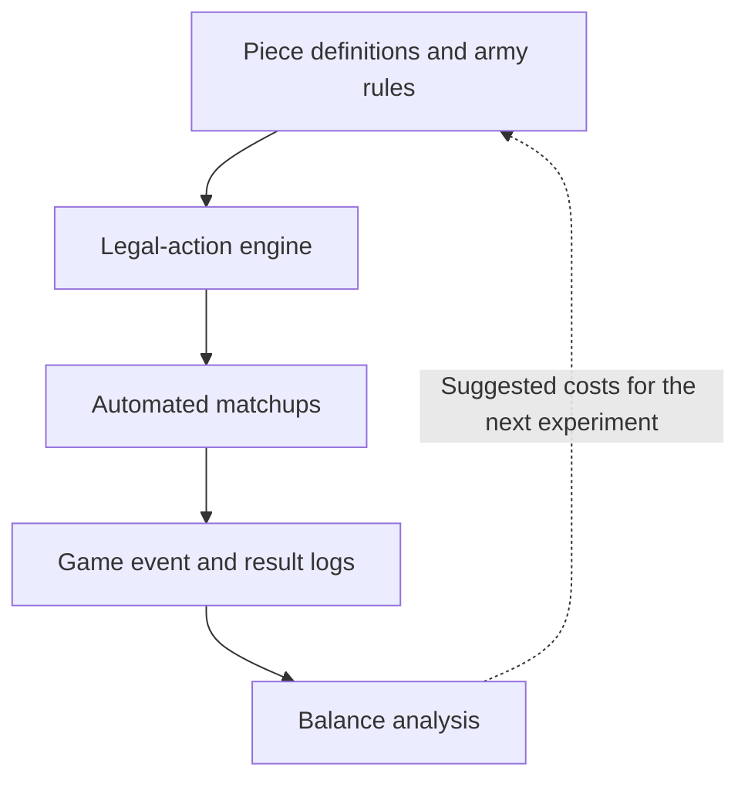

# Architecture and balancing methodology

This page is a technical companion to the [project overview](../README.md). It summarizes the major subsystems and the progression from a rules engine to evidence-based cost recommendations.

## System flow

## Game systems architecture

**Data vs. state.** [`PieceDefinition`](../src/models.py) is immutable and describes each piece's type, cost, movement, and traits. `PieceInstance` keeps mutable per-game state such as position, movement history, and shield charges. JSON loading is validated in [`piece_loader.py`](../src/piece_loader.py).

**Normal and special actions.** [`moves.py`](../src/moves.py) produces candidate destinations for different movement patterns. [`actions.py`](../src/actions.py) handles special abilities such as swap, leap, and opponent-controlled movement. [`rules.py`](../src/rules.py) combines actions and filters out actions that leave a king vulnerable.

**Simulation records.** [`simulation.py`](../src/simulation.py) executes matchups. [`game_record.py`](../src/game_record.py) captures individual actions and aggregate results so analysis can be performed separately from gameplay logic.

**Parallel experiments.** [`run_matchup.py`](../src/run_matchup.py) uses `ProcessPoolExecutor` for independent matches. Game seeds are derived from a base seed and game index, so experiments can be rerun with consistent initial inputs.

## How piece costs are estimated

The project explored two complementary approaches:

1. **Event-based efficiency:** [`balance.py`](../src/balance.py) combines gameplay measurements such as captures, survival, checks, mobility, and ability usage into an estimated value relative to cost. A damped update suggests new costs instead of jumping directly to the estimated value.
2. **Outcome-based estimation:** [`report/report_v2.py`](../src/report/report_v2.py) builds a matchup feature matrix and fits a ridge-regularized logistic model to game outcomes. It estimates relative piece strength, calibrates against standard chess pieces, and reports cost suggestions with uncertainty and supporting-game counts.

The outcome-based model was a methodological extension of the initial event-based formula. Both are estimates: differences in army composition, deployment, opponent strategy, and sample coverage affect conclusions.

## A controlled replacement experiment

For a custom piece such as the **Arcane Priest**, compare an experimental army against a baseline army in which the corresponding slot contains a standard **Bishop**. Repeated games provide an empirical comparison of their performance. More diverse replacement contexts help distinguish a piece's value from the influence of the surrounding army composition.

## Scope of this release

The repository contains source code, configuration data, and tests. It does not include the full experiment archive, large generated workbooks, or third-party artwork. The project was developed as a two-week UW PCE Game Design assignment in 2026.
