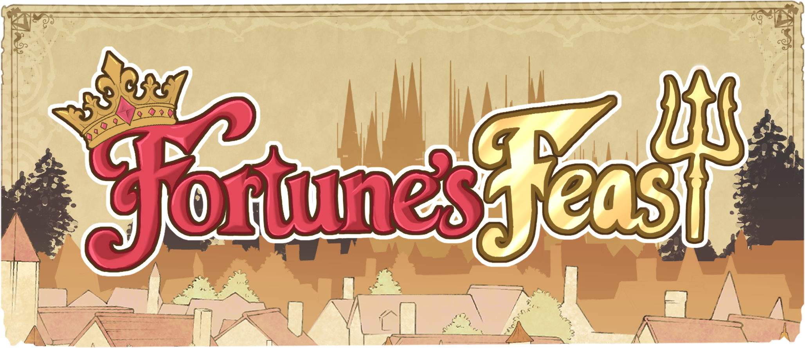

  

<h1 align="center">Fortune's Feast</h1>

  <strong>Game Systems Showcase · Technical Art · Art Direction</strong>

  Godot · GDScript · Character Interaction · UI Programming

  <a href="https://sleepypuppystudios.itch.io/fortunes-feast"><strong>🎮 PLAY THE GAME ON ITCH.IO</strong></a>

*Fortune's Feast* is a narrative deduction and menu-building game set in a royal court. As the palace chef, players investigate guests' preferences and relationships, choose dishes for a banquet, and discover how their decisions shape each night's reception and the final newspaper ending.

Created with **Sleepy Puppy Studios** as part of the **University of Washington PCE Game Design program (2026)**.

## My contributions

I worked across **art direction, 2D character and environment art, technical art, and programming**. My technical responsibilities included building character-presentation and interaction systems, integrating character assets into Godot, and implementing the UI, scoring feedback, and narrative presentation features.

This was a **team project**. The game scripts featured in this showcase and the custom application code in my standalone Technical Demo were authored by me; other game systems and some environment scene-dressing work were collaborative or developed by teammates.

## Engineering highlights

### 1. Character presentation and interaction

I developed reusable character components that combine visual presentation with player interaction:

- **`CharacterAssets`** maps character identities, layered artwork, and expression textures.
- **`CharacterController`** manages expressions, blinking, highlights, desaturation, animation, placement markers, and pointer hit detection.
- **`GossiperManager`** coordinates daily character placements, resolves clicks on overlapping characters by visual order, and responds to conversation and action state.

This separated character presentation from the higher-level conversation flow, making the artwork and interactions easier to adapt during production.

### 2. A standalone technical-art validation tool

Before finalizing the visual pipeline, I built a Godot **Technical Demo** to test character assets and the environment together. Its controls support character and expression selection, scaling, drag-to-position, glow and availability states, flipping, and dialogue/portrait previews.

The demo was used during **Stage 4: In-Engine Validation** of the background-production process. It helped assess composition and character presentation against the 3D environment blockout before the final 2D artwork was completed.

### 3. Scoring feedback and narrative presentation

I also implemented portions of the end-of-day experience, including preference-based dish feedback, sequential star animations, and the newspaper presentation that selects headlines based on guests' outcomes. This connected gameplay results to clear visual and narrative feedback.

## Art and technical production

| Character development | Environment development |
| --- | --- |
| Art-style exploration | Design exploration |
| Color palettes and silhouette studies | Set dressing and 3D modeling |
| Visual-style development | **In-engine validation with the Technical Demo** |
| Final character artwork | Final 2D environment render |

I used phased asset production and placeholders so art development and engineering could progress together. Environment planning and scene dressing also involved collaboration with the team.

## About this showcase

This folder documents **my contributions to a collaborative game**, not the entire studio's source code. The accompanying technical walkthroughs and selected source examples will focus on implementation decisions that I made, while preserving attribution for team contributions and third-party assets.
