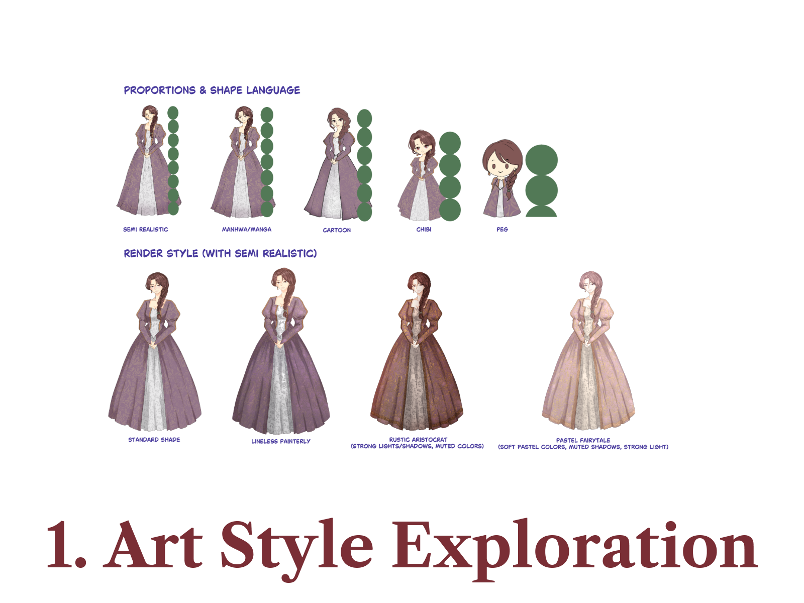
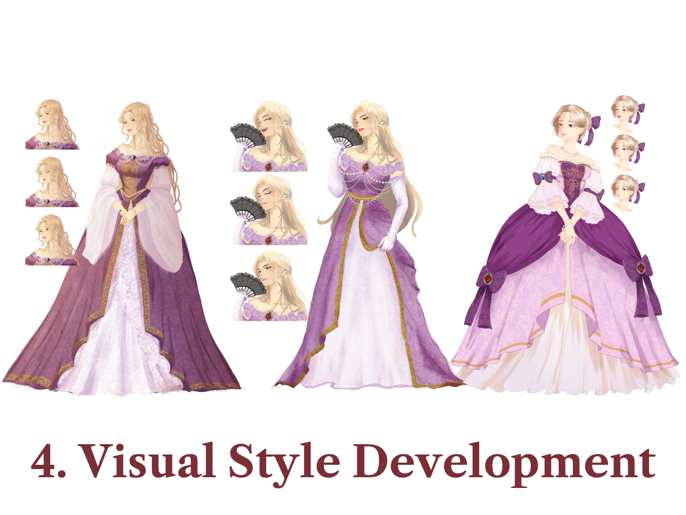
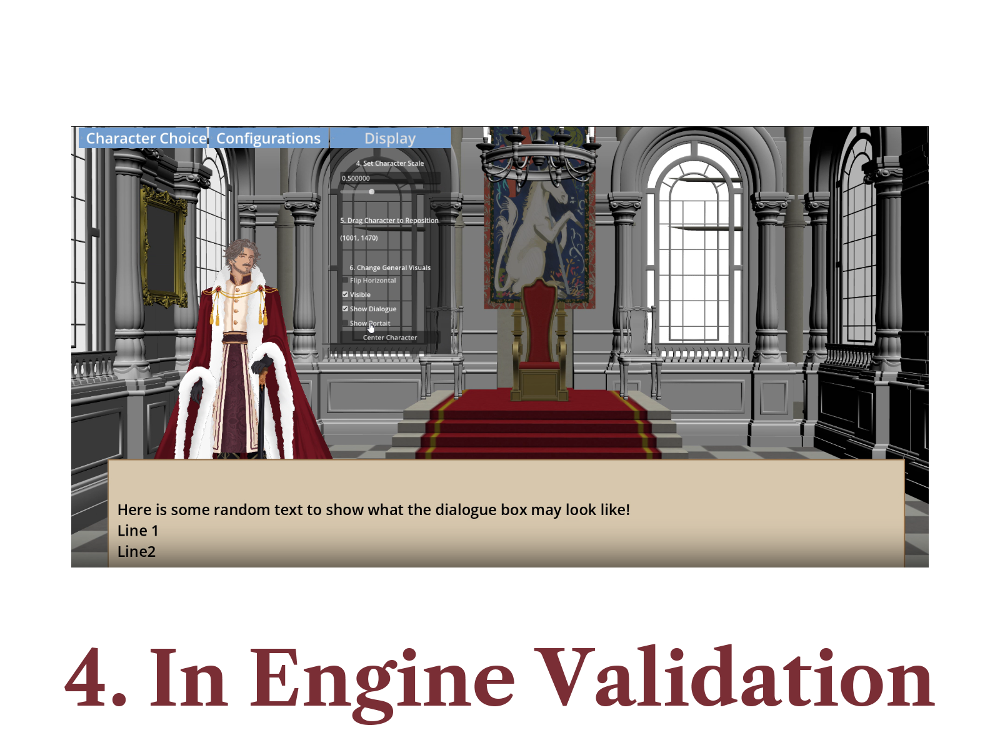
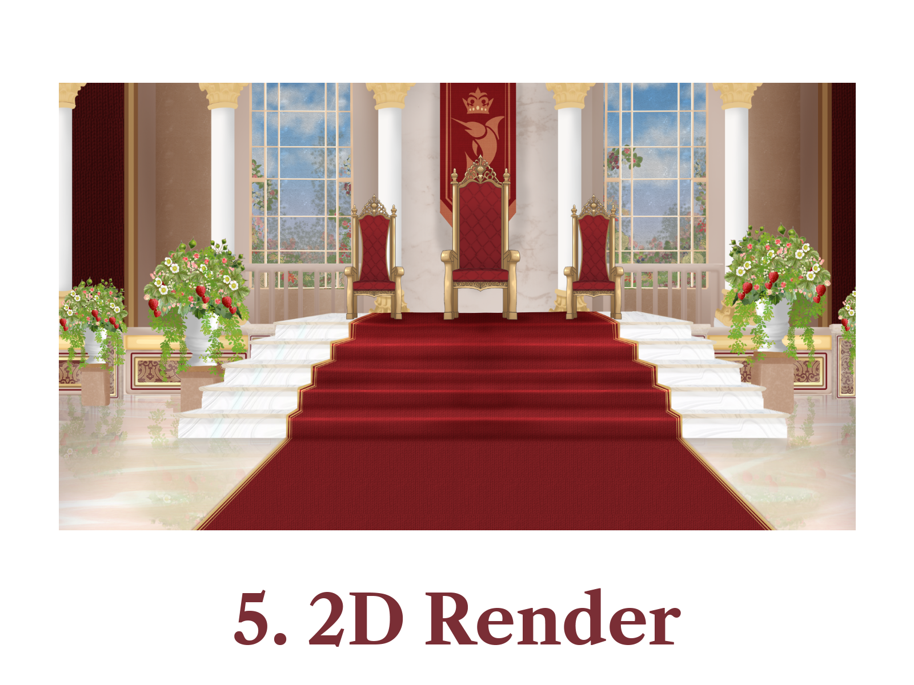

# From Art to Engine: The Fortune's Feast Production Pipeline

**Art direction · Technical art · Godot prototyping · Asset integration**

Creating *Fortune's Feast* meant developing a coherent historical-fantasy visual style while ensuring that characters, environments, and dialogue remained usable in the game. My approach was to work in phases, test visual decisions in-engine, and refine the artwork once the technical constraints were clearer.

I led the visual direction and built the standalone validation tool described below. Environment scene dressing and parts of integration were collaborative team efforts.

## 1. Developing the character direction

The character pipeline started with proportion and rendering experiments: realistic, manhwa-inspired, cartoon, and chibi approaches. I settled on a **semi-realistic, romance-fantasy-inspired** direction that felt elegant but retained some whimsical charm.

<p align="center">
  <a href="../assets/process/character/01-style-exploration.webp">
    
  </a>
</p>

Color palettes and silhouettes helped distinguish roles and social standing. Royal characters used richer burgundy, gold, and purple accents, while other court figures drew from more subdued palettes. I then developed expressions and layered artwork suitable for animation and dialogue.

<p align="center">
  <a href="../assets/process/character/04-visual-development.webp">
    
  </a>
</p>

The detailed character stages are available in the [process gallery](#process-image-gallery) below.

## 2. Blocking out the environment before final rendering

For the Great Hall, the process moved from design exploration and set dressing into a 3D scene. The 3D blockout provided a way to test composition, perspective, and the scale of important architectural elements before committing to the final painted 2D environment.

This was especially important because character art and interface elements needed to share the screen with the background. Some set-dressing and environment decisions were made collaboratively.

## 3. In-engine validation with my Technical Demo

**Stage 4, `InEngineValidation`, shows the standalone Godot Technical Demo I programmed.** It was a production tool rather than a scene from the finished game.

The demo let me select characters and expressions, adjust scale, drag character positions, toggle visual states, and preview portrait and dialogue presentation against the environment. This made it possible to assess the relationship between character art, the background, and the user interface before the final 2D rendering pass.

<p align="center">
  <a href="../assets/process/background/04-in-engine-validation.webp"> 
    
  </a>
</p>

One useful implementation detail was anchoring a character by their **feet marker** rather than guessing an offset. The demo converted a desired screen-space position into world coordinates before repositioning the character:

```gdscript
var feet: Marker2D = current_character.get_feet_marker()
if feet == null:
    return

var viewport_size = get_viewport_rect().size
var target_screen = Vector2(viewport_size.x / 2.0, viewport_size.y)
var target_world = get_viewport().get_canvas_transform().affine_inverse() * target_screen
var offset = target_world - feet.global_position
current_character.global_position += offset
```

*Excerpt from my Technical Demo's `character_showcase_v2.gd`. The full demo also includes configurable scaling, expression previews, drag controls, and visual-effect toggles.*

## 4. Finishing the 2D background

After the environment and character presentation had been explored in-engine, I used the 3D work as a foundation for a stylized 2D render. The final artwork emphasized the royal atmosphere through warmer materials, decorative elements, lighting, and a more deliberate color treatment.

<p align="center">
  <a href=".../assets/process/background/05-2d-render.webp">
    
  </a>
</p>

## What this approach taught me

- **Validate composition early.** A temporary in-engine test can reveal scale, placement, and interface conflicts before final artwork is committed.
- **Keep assets iterative.** Prototypes and placeholders let engineering progress while character and environment assets are still evolving.
- **Coordinate integration details sooner.** Establishing animation and asset requirements with programmers earlier would have reduced some later adjustments.

The Technical Demo was an intermediate development tool, not the final runtime architecture; parts of its character-control approach were subsequently adapted and extended for the game.

## Process image gallery

The full five-stage sequences are preserved here for readers who want to inspect the design work in more detail.

| Stage | Character development | Environment development |
| --- | --- | --- |
| 1 | [Art-style exploration](../assets/process/character/01-style-exploration.webp) | [Design exploration](../assets/process/background/01-design-exploration.webp) |
| 2 | [Color palette design](../assets/process/character/02-color-palette.webp) | [Set dressing](../assets/process/background/02-set-dressing.webp) |
| 3 | [Silhouette studies](../assets/process/character/03-silhouettes.webp) | [3D modeling](../assets/process/background/03-3d-modeling.webp) |
| 4 | [Visual-style development](../assets/process/character/04-visual-development.webp) | [In-engine validation](../assets/process/background/04-in-engine-validation.webp) |
| 5 | [Art production](../assets/process/character/05-art-production.webp) | [Final 2D render](../assets/process/background/05-2d-render.webp) |
