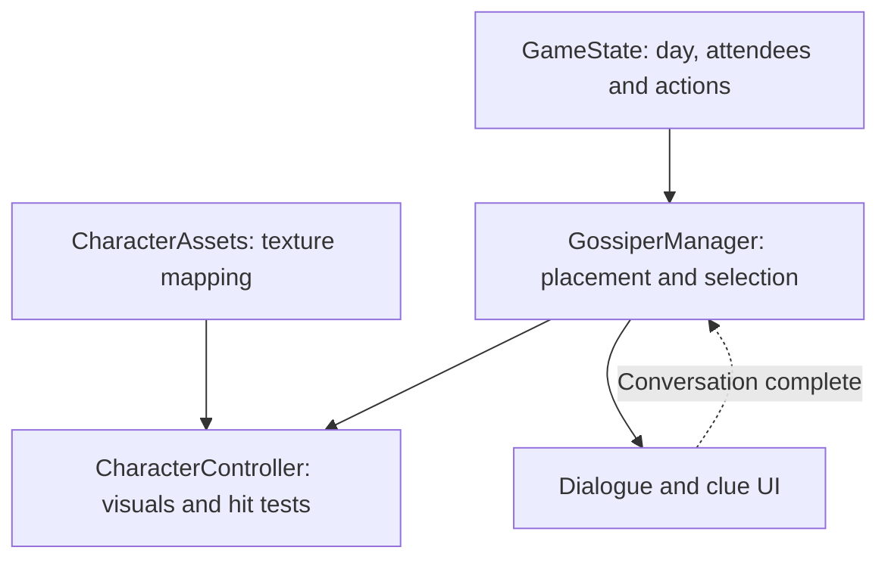

# Character Interaction: From Artwork to Conversation

**Godot / GDScript · Character systems · Input handling · State-driven presentation**

In *Fortune's Feast*, the player investigates a rotating group of court attendees over three days. Those characters can appear in different positions, overlap visually, and become unavailable after a conversation. The interaction system needs to keep selection, artwork, and game state aligned without custom logic for every character.

I implemented three components to address that problem:

| Component | Responsibility | Source |
| --- | --- | --- |
| **CharacterAssets** | Maps character identities to layered textures and expression assets | [`CharacterAssets.gd`](../code/character-system/CharacterAssets.gd) |
| **CharacterController** | Handles appearance, animation, hit testing, and interaction state for one character | [`CharacterController.gd`](../code/character-system/CharacterController.gd) |
| **GossiperManager** | Manages the day's character roster, positions, selection, and conversation transitions | [`GossiperManager.gd`](../code/character-system/GossiperManager.gd) |



*`GameState`, the dialogue controller, and the broader UI are part of the team game's surrounding architecture and are not included in this curated code selection.*

## The interaction sequence

1. **Position characters for the day.** `GossiperManager` reads day-specific `Marker2D` nodes and supplies positions and draw order to each `CharacterController`.
2. **Determine eligibility.** The character controller checks visibility, activity, previous conversations, and whether the player's book is open. It tests the mouse against a polygon matching the artwork rather than relying only on a rectangular control.
3. **Resolve overlap.** On click, the manager checks current-day candidates and chooses the hovered character with the highest `z_index`.
4. **Start conversation.** The selected character moves into the conversation position. The manager emits `character_clicked` so the dialogue system can respond.
5. **Apply the outcome.** When dialogue finishes, the manager marks the attendee as spoken to, changes their presentation, restores the other characters, records a clue, and consumes an action.

### Code highlight: selecting the intended character

```gdscript
func get_topmost_hovered_character() -> CharacterController:
    var hovered: CharacterController = null

    for child in get_current_day_gossipers().keys():
        var character = gossipers_available[child]
        if not character.is_mouse_over():
            continue

        if hovered == null or character.z_index >= hovered.z_index:
            hovered = character

    return hovered
```

The key decision is to evaluate **the current day's eligible characters** and use their visual ordering to resolve clicks. This addresses an issue that arose when character portraits overlapped in the scene.

## Reusable visual-state controls

`CharacterController` provides shared operations for expressions, highlights, desaturation, blinking, sprite movement, and activity states. It also supports a combined `set_character_state()` entry point so other game systems can request changes without reproducing the underlying animation or shader logic.

Character textures are resolved through `CharacterAssets` using character, body-part, and expression identifiers. If a requested expression texture is missing, the code falls back to the neutral expression where available. This kept expression behavior flexible as the art assets evolved.

## Engineering tradeoffs

- **Shared controllers reduced repetition.** New characters could reuse presentation and interaction behavior, while asset differences stayed in the mapping.
- **Polygon hit testing matched irregular artwork.** It improved selection accuracy but required collision polygons and careful input coordination.
- **The manager depends on the game's global state and UI services.** That made integration practical for the team project, but a more isolated version would be easier to test independently.

The full scripts here are **selected original source files**, not a runnable Godot project. They rely on game-specific resources, scenes, enums, and team systems that are intentionally not redistributed.

For the art-production context behind these character assets, see [From Art to Engine](art-to-engine-pipeline.md).
