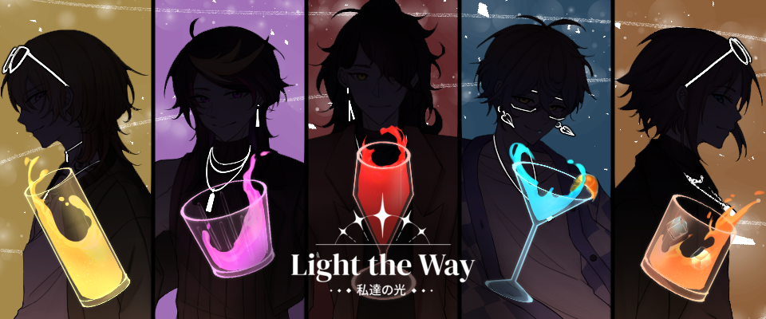

<h1 align="center">Light the Way</h1>

  <strong>Shared Game Systems · Progression & Unlockables · Developer Enablement</strong>

  Ren'Py · Python · UI Programming · Persistent State

  <a href="https://simporiem-studios.itch.io/light-the-way"><strong>🎮 GET THE GAME ON ITCH.IO</strong></a>

---

*Light the Way* is a fan-made, branching visual novel with five character routes and multiple endings. Choices affect the story, while achievements and unlockable artwork and music reward players for exploring different outcomes.

**Studio:** Simporiem Studios · **Year:** 2023 · **My role:** Lead Programmer

## My contribution

I led development of the game's core Ren'Py systems, implementing and maintaining functionality shared across multiple story routes. My work included progression tracking, achievements, unlockable media galleries, asset registries, UI behavior, and integration interfaces used by other contributors.

I also wrote example scenes and recorded demonstrations showing teammates how to use these features. Separately, I helped contributors set up GitHub, use pull requests, and review changes. I reviewed other team members' scripts, but **their code is not presented here as my own**.

## Engineering highlights

### 1. Cross-route progression and achievements

I built helpers to record and query endings by character and outcome, track completion across playthroughs, and connect story milestones to achievements and unlockable content.

The implementation uses Ren'Py's built-in persistence and achievement functionality, with project-specific logic for route completion, achievement conditions, and notifications. The relevant scripts include `game-ending-declarations.rpy` and `achievements.rpy`.

### 2. Unlockable gallery and asset organization

I connected background, CG, sprite, and music registries to a gallery where players can browse unlocked content. The interface supports route-based filtering, pagination, and music playback, while engine tracking determines which items have been seen or heard.

This required coordination across `backgroundAssets.rpy`, `musicAssets.rpy`, and `Gallery.rpy`. Explicit registries made the content easier to categorize, though they also required updates as the game's asset library grew.

### 3. Making shared systems usable by teammates

I created `EXAMPLE_*.rpy` scenes to demonstrate how other developers could invoke shared features from ordinary story scripts, including ending checks, gallery unlocks, sound, choice indicators, and phone interactions.

For the phone example, I also recorded a side-by-side walkthrough showing the Ren'Py script alongside its in-game behavior: text messages, group-chat participants, and incoming calls. The underlying phone concept drew on existing approaches; the contribution highlighted here is its implementation, integration, and documentation for the team.

## Technical leadership

Beyond programming, I supported the team's development workflow by onboarding contributors to GitHub and pull requests, reviewing scripts, and providing runnable examples and demonstrations. These efforts helped other contributors work with shared systems without needing to understand every implementation detail.

## About this showcase

This is a **curated engineering case study**, not a redistribution of the complete game. The highlighted systems were developed in the context of a collaborative fan project; narrative writing, game artwork, and music belong to their respective contributors and rights holders.

The scripts discussed here depend on the wider Ren'Py game and are not standalone runnable examples. The [official game page](https://simporiem-studios.itch.io/light-the-way) is the source for the complete release.
