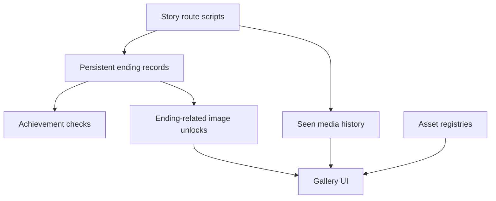

# Persistent Progression & Unlockable Content

**Ren'Py · Python · Cross-route state · Achievements · Media galleries**

*Light the Way* has five character routes and several possible endings. Players can return to the game to discover different outcomes, earn achievements, and unlock artwork and music. The engineering challenge was to give different story scripts a consistent way to record progress while keeping the unlockable content organized.

I implemented the project-specific progression and gallery logic on top of Ren'Py's built-in persistence, achievement, and media-history features.



## 1. Recording and querying endings

A route script can call `add_ending(route, ending)` when the player reaches an outcome. The function updates persistent lists for **Hope**, **Dark**, and **Rainbow** endings, records the overall completion history, and unlocks related images.

Other scripts can then ask questions without manually inspecting those lists:

```python
check_ending_reached("Vox", "Hope")
get_ending_count("Any", "Rainbow")
```

These examples use the original function interfaces; they are called within Ren'Py scripts, not a standalone Python application. The [ending-query excerpt](../code/progression/ending-tracking.rpy) preserves the original query implementations while omitting route-specific asset declarations.

## 2. Connecting completion to achievements

Achievement rules build on those persistent outcomes. For example, completing every character's Hope ending can grant a collection-wide achievement. The shared `grant_achievement(title)` helper checks whether an award is already owned, grants it through Ren'Py's achievement API, updates the displayed total, and triggers a notification.

This helped separate *when* a narrative event should award something from *how* that award appears to the player.

**Source:** [Achievement awarding excerpt](../code/progression/achievement-awards.rpy). The full script also contains achievement metadata and icon references, which are not reproduced here.

## 3. Cataloging unlockable images and music

The gallery combines multiple content types:

- **Backgrounds, CGs, and sprites:** Explicit registries group image identifiers by category and character route.
- **Unlock status:** Ren'Py's seen-image history determines whether individual artwork has been encountered. Some endings also mark related images as seen.
- **Music:** A `MusicRoom` registers tracks and allows players to revisit music they have heard.
- **Navigation:** `Gallery.rpy` provides category tabs, route filters, pagination in groups of six, and music selection.

For example, `switch_filter()` resets the current page when a player chooses a different route. `get_max_page()` calculates a page count from the filtered image list or music catalog.

**Source:** [Gallery navigation excerpt](../code/gallery/gallery-navigation.rpy). The larger image declarations and screen-layout code are intentionally omitted.

## Tradeoffs and lessons

- **Explicit registries were easy to understand.** Content could be grouped predictably by route, but each new asset required a corresponding registry update.
- **Ren'Py integration reduced custom infrastructure.** I reused the engine's persistence and media-history features, while the project-specific helpers coordinated endings, rewards, and UI presentation.
- **The systems were tightly coupled to game globals and content identifiers.** In hindsight, separating the state queries from screen behavior and adding focused tests for edge cases would make them easier to maintain.

## Scope of the code excerpts

These are **trimmed excerpts of my original project scripts**, not a complete or runnable Ren'Py game. Function names and behavior are preserved, but unrelated story content, large art/music declarations, and surrounding engine or UI dependencies are excluded. Other contributors' narrative, artwork, and music are not presented as my own.

[← Back to the Light the Way overview](../README.md)
