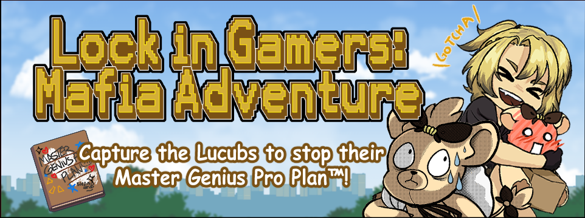

  

<h1 align="center">Lock In Gamers: Mafia Adventure</h1>

  <strong>Gameplay Systems Showcase</strong>

  Godot 4.4 · GDScript · Game Systems · State Management

  <a href="https://hacstudios.itch.io/lock-in-gamers-mafia-adventure">
    <strong>🎮 PLAY THE GAME ON ITCH.IO</strong>
  </a>

---

**Lock In Gamers: Mafia Adventure** is a single-player exploration game where you play as mafia boss Luca Kaneshiro, 
investigating why your henchmen (the Lucubs) have been acting so suspiciously. 
Explore the castle grounds, capture Lucubs, gather clues and rewards, and unlock new areas to uncover what they've been up to.

**My contribution:** I served as the game's sole programmer,
implementing player interactions, creature behavior, progression,
game-state persistence, and their connections to the game's
dialogue and animation systems.

---

## The engineering challenge

The game's progression spans several systems. Discovering a Lucub changes how it behaves; catching it leads to a cutscene and a collectible; collecting the reward may unlock another room. These events must also survive leaving and resuming a session.

I connected these mechanics using **explicit states, Godot signals, resource-backed data, and a shared session model**.

## The core gameplay sequence

1. **Discover:** A detection area finds the player and changes a Lucub from `IDLE` to `SURPRISED`.
2. **Chase:** An animation callback moves it into `RUNNING_AWAY`, then `ALERT` when it reaches its destination.
3. **Capture:** A player interaction starts the capture cutscene and eventually marks the Lucub `CAUGHT`.
4. **Collect:** The Lucub's animation emits `spawn_box`, creating a collectible gift box.
5. **Unlock:** Collecting the item updates session progress and can start the corresponding door-opening sequence.

For the system connections, see [Gameplay architecture](docs/architecture.md).

## Code reading guide

| Focus | Start here | What to look for |
| --- | --- | --- |
| **Creature state machine** | [`Lucub_Controller.gd`](source/Scenes/Lucub/Lucub_Controller.gd) | State restoration, detection, pursuit, capture, collision zones, and signal emission |
| **Event-driven rewards** | [`BoxSpawner.gd`](source/Scenes/Giftbox/BoxSpawner.gd) and [`GiftBox_Controller.gd`](source/Scenes/Giftbox/GiftBox_Controller.gd) | Dynamic instances, signal wiring, collecting items, and triggering doors |
| **Progression and persistence** | [`SessionManager.gd`](source/Script/Manager/SessionManager.gd) and [`PlayerData.gd`](source/Script/Resource/PlayerData.gd) | Tracking Lucub states, rewards, room unlocks, and saved resources |
| **Player interaction** | [`Player_Controller.gd`](source/Scenes/Player/Player_Controller.gd) | Resolving nearby interactables and dispatching capture/collection actions |
| **Door logic** | [`Door.gd`](source/Scenes/Door/Door.gd) and [`DoorManager.gd`](source/Scenes/Door/DoorManager.gd) | Creature-to-door mapping and visual/collision updates |

## A design tradeoff

Central session state makes progress readily available to the game world and interface, but also couples multiple systems to one manager. If rebuilding the project, I would consider more strongly typed progression events and a dedicated progression service to reduce these dependencies.

## Scope of this repository folder

This is a **curated source-code walkthrough**, not a standalone runnable Godot project. The original scripts are reproduced without rewriting their implementations, and some reference scenes, assets, or third-party addons that are not distributed here. The full game uses additional content beyond these files.

Fan-related artwork, audio, dialogue, and external addons have been intentionally omitted. No new license is granted by this showcase; reuse of any code or assets requires the appropriate rights.
