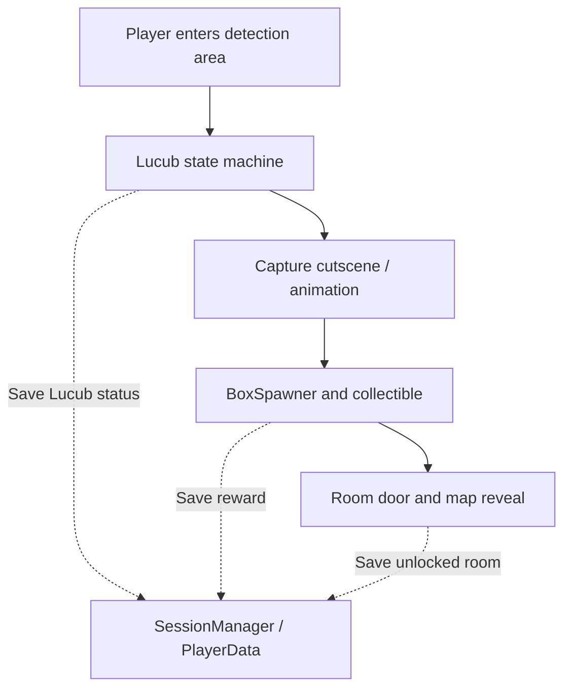

# Gameplay architecture: From discovery to progression

This walkthrough focuses on the game's main engineering loop: a creature changes state, an interaction triggers a reward, and the reward affects persistent world progression.

## 1. Stateful creature behavior

In [`Lucub_Controller.gd`](../source/Scenes/Lucub/Lucub_Controller.gd), a Lucub uses the states `IDLE`, `SURPRISED`, `RUNNING_AWAY`, `ALERT`, and `CAUGHT`. Entering the player's detection area triggers a state change. The controller adjusts its collision shape for each state so detection and interaction match the creature's behavior.

The controller also restores its previously saved state on `_ready()`. For example, an already-caught creature does not restart its escape sequence when the player reloads a game.

Godot's animation method tracks contribute to the transition logic: the original `lucub.tscn` calls methods such as `finished_surprised()`, `spawn_gift()`, and `finished_caught()`. This is a useful example of coordination between gameplay state and presentation timing.

## 2. Reward events and progression

The original story-mode scene connects each Lucub's `spawn_box` signal to [`BoxSpawner._on_spawn_gift()`](../source/Scenes/Giftbox/BoxSpawner.gd). The spawner creates a gift box and connects its `open_door` and `start_dialogue` signals to the relevant orchestration methods.

When an item is collected, [`GiftBox_Controller.gd`](../source/Scenes/Giftbox/GiftBox_Controller.gd) marks it in `SessionManager` and starts the associated dialogue. After dialogue completion, the reward can open the mapped door. [`Door.gd`](../source/Scenes/Door/Door.gd) updates the corresponding unlocked-room flag, animation, and collision.

The creature-to-door relationship comes from `DoorsToUnlock_ByLucub` in [`GlobalConstants.gd`](../source/Script/Manager/GlobalConstants.gd); not every Lucub is associated with a door.

## 3. Persisting the consequences

[`PlayerData.gd`](../source/Script/Resource/PlayerData.gd) is a Godot `Resource` containing three particularly important sets of data:

| Data | Purpose |
| --- | --- |
| `LucubsStatus` | Restore creature state after loading |
| `GiftsStatus` | Remember which rewards have been collected |
| `UnlockedRoomVeil` | Restore access to areas of the map |

[`SessionManager.gd`](../source/Script/Manager/SessionManager.gd) exposes methods for updating these values and saving/loading the resource through Godot's resource system. This enables progression across sessions, though the original implementation relies on a shared global manager.